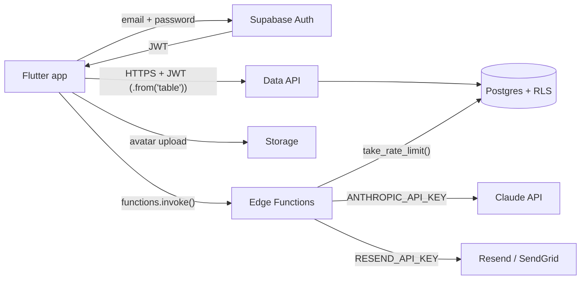
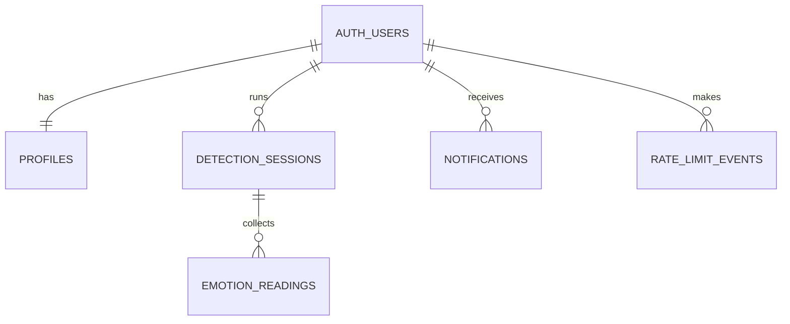

# MEDS backend guide

How the MEDS backend works, why it is built this way, and how it copes as the
number of users grows. Read it top to bottom once; later use it as a map.

## 1. What "the backend" is

MEDS has no server of its own to run. Its backend is **Supabase**, a hosted
service that bundles the usual backend parts:

| Part | What it does in MEDS |
|---|---|
| **Postgres database** | Stores profiles, sessions, readings, notifications. |
| **Auth** | Sign-up / sign-in. Gives the app a **JWT**: a signed token that says "this is user X", valid for 1 hour and refreshed automatically. |
| **Data API** (PostgREST) | Turns every table into an HTTPS endpoint. Every `Supabase.instance.client.from('table')...` call in the app goes here. |
| **Row Level Security (RLS)** | Rules inside Postgres that decide which rows each user may read or write. |
| **Storage** | Profile pictures (bucket `avatars`). |
| **Edge Functions** | Small TypeScript servers for jobs that need a secret: `ai-proxy` (calls Claude) and `send-data-email` (calls Resend / SendGrid). |

## 2. Follow one request

During a live session the app saves a reading every 5 seconds
(`SupabaseService.saveReading`). What happens:

1. The app sends `POST /rest/v1/emotion_readings` with the reading as JSON and
   the header `Authorization: Bearer <JWT>`.
2. The Data API checks the JWT signature, then runs the insert in Postgres as
   the role `authenticated`. Inside SQL, `auth.uid()` now returns the user id
   from the token.
3. Postgres checks the table's RLS policy `readings_insert`: the row's
   `user_id` must be `auth.uid()`, and its `session_id` must be one of that
   user's sessions. If not, the insert is refused.
4. The row is written and the table's indexes are updated.

**The key idea:** the app is not trusted. The publishable key is inside every
APK, so anyone can call the Data API directly with their own token and skip
the app. Every rule that matters must therefore live in the database (RLS,
triggers) or in an Edge Function. A check that exists only in Dart is a
convenience, not security.

## 3. Data model

| Table | One row per | Notes |
|---|---|---|
| `auth.users` | account | Managed by Supabase Auth. Holds the password hash and `banned_until`. |
| `profiles` | account | `role` (user / admin), `status` (active / inactive / blocked), sign-up answers, settings. Created automatically by the `handle_new_user` trigger at sign-up. |
| `detection_sessions` | monitoring session | Start / end time, status, summary numbers (`dominant_emotion`, `average_bpm`, ...), the AI summary. |
| `emotion_readings` | 5 seconds of a session | `emotion`, `confidence`, `hr`, `spo2`, `session_id`, `user_id`. By far the biggest table (about 720 rows per hour of monitoring). |
| `notifications` | in-app notification | The user's inbox. |
| `rate_limit_events` | AI or email call | Kept for one day, used only by `take_rate_limit()`. Clients cannot read it. |

## 4. Who can do what

RLS policies, after `supabase_setup_hardening.sql`:

| Table | Normal user | Admin |
|---|---|---|
| `profiles` | Read and edit own row, but **cannot change `role` or `status`** | Read and edit every row |
| `detection_sessions` | Read, create, edit, delete own | Read and edit every row |
| `emotion_readings` | Read, insert, delete own; insert only into own sessions | Read every row |
| `notifications` | Own only | Own only |
| Storage `avatars` | Anyone can view; upload only into a folder named after own id | Same |
| `rate_limit_events` | No access | No access |

An **admin** is a profile with `role = 'admin'`; SQL checks it with
`public.is_admin()`. Some functions are `security definer`: they run with the
owner's rights instead of the caller's, so they can do things a user cannot
(read every profile, ban an account). Each one checks who is calling first:
`is_admin`, `admin_delete_user`, `take_rate_limit` and the profile triggers.

## 5. Where the backend is defined

| What | Where | How it reaches the live project |
|---|---|---|
| Tables, policies, functions | `supabase_setup*.sql` in the repo root | Pasted into **Dashboard → SQL Editor**, in the order below. Every file is safe to re-run. |
| Edge Functions | `supabase/functions/<name>/index.ts` | CI deploys them on every merge to `main` (`.github/workflows/ci.yml`). |
| Secrets (`ANTHROPIC_API_KEY`, `RESEND_API_KEY`, ...) | Supabase **Edge Functions → Secrets** | Set by hand, never in the repo. |
| Security tests | `supabase/tests/security_test.mjs` | Run locally: `cd supabase/tests && npm install && npm test`. |

SQL run order: `supabase_setup.sql`, `_sessions`, `_admin`, `_user_analytics`,
`_notifications`, `_session_summary`, `_session_review`, `_profile_extras`,
`_registration_fields`, `_admin_user_mgmt`, then `_hardening`.

## 6. What the hardening changed, and why

`supabase_setup_hardening.sql` fixes five problems:

1. **Any user could make themselves admin.** The old "update own profile"
   policy allowed every column, so `update profiles set role = 'admin'` worked
   from any account, and an admin can read everyone's data. Now a trigger
   (`guard_profile_privileges`) keeps `role` and `status` unchanged unless an
   admin makes the change.
2. **Blocking was cosmetic.** Only the app's start screen looked at
   `status = 'blocked'`, so a blocked user could still use the API. Now when
   an admin blocks or deactivates someone, a trigger (`sync_profile_ban`) also
   bans the account in Supabase Auth: it cannot sign in or refresh its token.
   A token already issued keeps working until it expires, at most an hour.
3. **Security rules were re-checked for every row.** A policy written as
   `auth.uid() = user_id` runs `auth.uid()` once per row scanned. Written as
   `(select auth.uid()) = user_id`, Postgres runs it once per query. Pairs of
   overlapping policies (own + admin) were merged into one per action. Same
   rules, much less work on large tables.
4. **Missing indexes.** An index is a sorted copy of some columns that lets
   Postgres jump straight to the rows it needs, like a book index. Without
   one, "my sessions, newest first" read and sorted the whole table, and got
   slower as other users added data. Each new index matches a real query in
   the app, for example `detection_sessions (user_id, start_time desc)`.
5. **No abuse limits.** Each Claude call costs money, and `send-data-email` will
   send to any address. Now each user gets 30 AI calls and 10 emails per hour,
   counted in the database by `take_rate_limit()`. Above the limit the
   function answers `429 Too Many Requests`, and the app shows the message.

## 7. How it copes with many users

- **Reads stay fast as data grows.** Each user's queries filter by their own
  id and use a matching index, so the cost depends on how many rows come back,
  not on how big the table is.
- **No database connection per phone.** The app talks HTTPS to the Data API,
  which shares a small pool of database connections. 10,000 phones do not
  mean 10,000 connections.
- **Writes are small and steady.** One person in a live session writes one
  reading every 5 seconds. A few hundred people in sessions at the same time
  is a modest load for Postgres; your Supabase plan's compute size and request
  quotas are the limits to watch (Dashboard → Reports).
- **Edge Functions scale out.** They keep no state, so Supabase runs more
  copies when traffic grows, and the rate limits cap what one user can cost.

### Known limits (next steps, not done yet)

1. **Admin screens count on the phone.** They download up to 1,000 profiles,
   the newest 500 sessions and the newest 1,000 readings, then count in Dart.
   Past those numbers totals stop being exact and pages load slower. Fix: SQL
   functions that return the totals directly.
2. **One request per reading.** Sending readings in batches (say six every 30
   seconds) would cut write requests six times.
3. **`emotion_readings` grows forever.** Decide how long to keep raw readings;
   sessions already keep their summary numbers.
4. **One environment.** Tests and real users share the live project. A
   separate staging project lets you try changes safely first.
5. **SQL is applied by hand.** Supabase CLI migrations (`supabase/migrations/`
   plus `supabase db push` in CI) would apply schema changes automatically and
   in order, like the Edge Functions are today.

## 8. Checking on it

- **Dashboard → Advisors**: Supabase's own security and performance checks.
  After the hardening, the `auth_rls_initplan` and
  `multiple_permissive_policies` warnings should be gone for these tables.
- **Dashboard → Logs**: API, Postgres and Edge Function logs. Edge Functions
  log errors with `console.error`.
- **Dashboard → Reports**: CPU, memory, requests over time.
- **`supabase/tests`**: run after any SQL change.

## 9. Applying the hardening (order matters)

1. Run `supabase_setup_hardening.sql` in **Dashboard → SQL Editor** on the
   live project.
2. Then merge the code change. CI deploys the Edge Functions, which now call
   `take_rate_limit()`. If the functions go live before step 1, AI summaries
   and email export answer "rate limit is not set up" until the SQL is run.
3. Check **Advisors**, then try an AI summary and an email export in the app.
